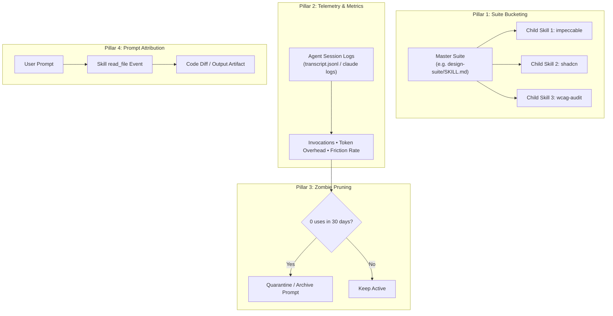

# SkillsGate Next-Gen: Suites, Bucketing & Telemetry Architecture

> **Context & Vision:**  
> Transform SkillsGate from a flat skill installer into the definitive **Application Performance & Management (APM)** suite for AI agent capabilities across Claude Code, Cursor, Antigravity, Windsurf, and other coding agents.

---

## 1. Executive Summary & Core Motivation

SkillsGate currently operates as a flat file manager for AI skills. While effective for initial discovery and multi-agent dispatch, it encounters severe limitations as workflows scale past 10–15 skills:

1. **Context Bloat & Attention Degradation:** Flatly injecting dozens of skills dilutes LLM attention and triggers instruction drift. Production workflows require **Progressive Disclosure** (Master Suites that expose high-level indexes and lazily disclose nested sub-skills on demand).
2. **Operational Blind Spots:** Developers cannot determine which skills are actively used versus which are dead weight burning tokens without adding value.
3. **Missing Causality:** When an agent generates code, developers cannot trace the exact causal chain: *What user prompt caused which skill to trigger, and what exact response did it produce?*

This roadmap outlines the staged architecture to introduce **Hierarchical Buckets (Suites)**, **Runtime Telemetry**, **Dead Skill Pruning**, and **Prompt Attribution** directly into SkillsGate.

---

## 2. The 5 Core Pillars



### Pillar 1: Hierarchical Bucketing (Progressive Disclosure)
* **Master Suite Detection:** Detect directories containing a root `SKILL.md` plus child directories that also have their own `SKILL.md`.
* **Container Representation:** The parent suite governs global boundaries, while nested sub-skills (e.g. `design-suite/impeccable/`, `design-suite/shadcn/`) are logically grouped within that bucket.
* **UI Bucket View:** Group skills visually under collapsible Suite Cards, while preserving the flat list view as a toggle.

### Pillar 2: Runtime Telemetry
* Parse local agent logs (`~/.gemini/antigravity-cli/brain/*/logs/transcript.jsonl`, `~/.claude/logs`, etc.) in read-only mode.
* Extract:
  * **Trigger Frequency:** Total times the skill's `SKILL.md` was read into context.
  * **Context Cost:** Token footprint added to conversation turns.
  * **Last Used:** Exact timestamp of the most recent invocation.

### Pillar 3: Dead Skill Pruning & Lifecycle
* **Zombie Score:** Identify skills with zero invocations over 14/30 days.
* **Friction Flag:** Identify skills where the user issued immediate correction/undo prompts within 1–2 turns of invocation.
* **One-Click Actions:** Move dead skills to an `_archive/` directory or toggle them off.

### Pillar 4: Prompt Attribution & Causal Inspector
* When viewing a skill in the preview drawer, render a **Causal History** tab:
  * **Timestamp & Agent:** When and where the skill ran.
  * **Triggering Prompt:** The verbatim user input that caused the model to read the skill.
  * **Output Artifact:** Files touched or created as a consequence.

### Pillar 5: Emerging Skills Radar & Staging
* Provide an **Inbox / Staging** area (`~/.agents/skills/_staging/`) for newly emerging community skills (e.g., *Headroom*, *Impeccable*).
* Test skills in isolation before committing them to a Master Suite bucket.

---

## 3. Atomic PR Roadmap

To ensure high maintainer acceptance, all changes are split into atomic, independently reviewable PRs with zero regressions.

| PR # | Branch Name | Target Layer | Scope & Deliverable | Risk |
| :--- | :--- | :--- | :--- | :--- |
| **PR #1** | `feat/suite-detection-model` | Backend & DB | Scanner recognizes parent-child suite hierarchy; adds `parent_suite` and `is_suite` to SQLite `cached_skills`. No visual changes yet. | **Zero** (100% backward compatible) |
| **PR #2** | `feat/suite-bucket-view` | Frontend UI | "Group by Suite" view toggle in `home.tsx`; collapsible suite cards; drag-and-drop between buckets. | Low |
| **PR #3** | `feat/telemetry-zombie-pruning` | Backend & UI | Local transcript watcher; aggregates invocation stats; adds "Zombie / Unused in 30d" sidebar filter. | Low |
| **PR #4** | `feat/causal-history` | Frontend UI | Adds "Activity / Prompts" history tab to the right-hand inspection drawer. | Low |

---

## 4. Technical File Impact Map

### Phase 1: Scanner & DB Migration
* [`apps/desktop/src/main/db/migrations.ts`](file:///Users/alhamdulillah/codespace/skillsgate/apps/desktop/src/main/db/migrations.ts):
  * Migration `v5`: Add `parent_suite TEXT`, `is_suite INTEGER DEFAULT 0` to `cached_skills`.
* [`apps/desktop/src/main/ipc-handlers.ts`](file:///Users/alhamdulillah/codespace/skillsgate/apps/desktop/src/main/ipc-handlers.ts):
  * Update `scanAgentSkills` to inspect child folders when scanning a directory containing `SKILL.md`.
  * Return `parentSuite` and `isSuite` in `skills:list-installed` payload.

### Phase 2: UI Suite View
* [`apps/desktop/src/renderer/routes/home.tsx`](file:///Users/alhamdulillah/codespace/skillsgate/apps/desktop/src/renderer/routes/home.tsx):
  * Add View Switcher: `[List | Grid | Suites]`.
  * Group `filteredSkills` by `parentSuite` or root suite.
* [`apps/desktop/src/renderer/components/suite-card.tsx`](file:///Users/alhamdulillah/codespace/skillsgate/apps/desktop/src/renderer/components):
  * Dedicated collapsible container card for suites.

### Phase 3 & 4: Telemetry & Activity
* `apps/desktop/src/main/telemetry/transcript-miner.ts`:
  * Parses JSONL transcripts from known agent runtimes.
* `apps/desktop/src/renderer/routes/skill-activity.tsx`:
  * Prompt history and attribution ledger.

---

## 5. Development & Git Workflow

```bash
# Repo Remotes
origin   https://github.com/hammaadworks/skillsgate.git (Your fork)
upstream https://github.com/skillsgate/skillsgate.git   (Upstream community repo)

# Syncing with Upstream
git checkout main
git fetch upstream
git merge upstream/main
git push origin main

# Creating Feature Branches
git checkout -b feat/suite-detection-model
```
